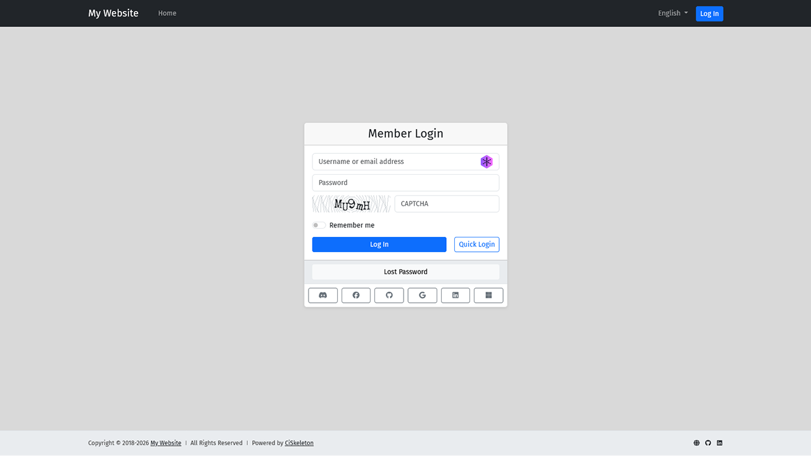
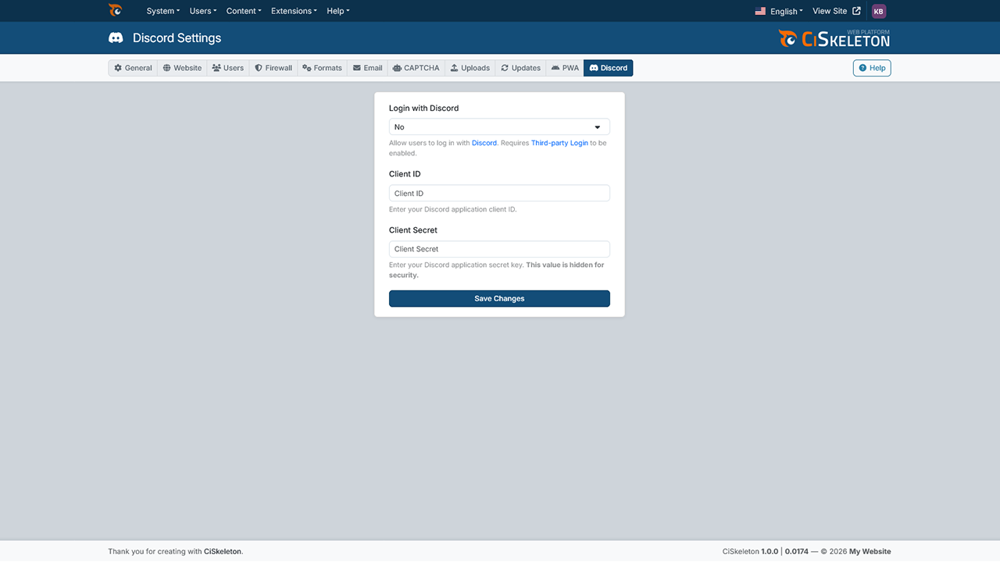
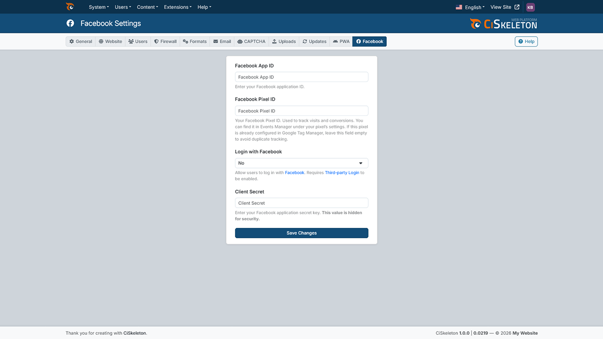
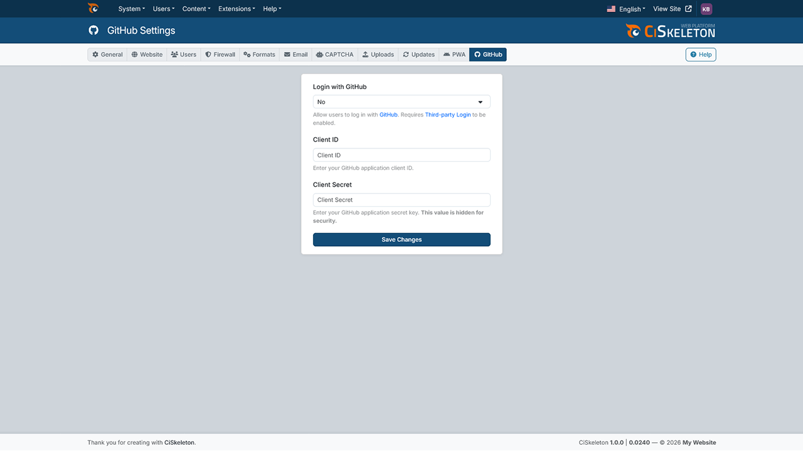
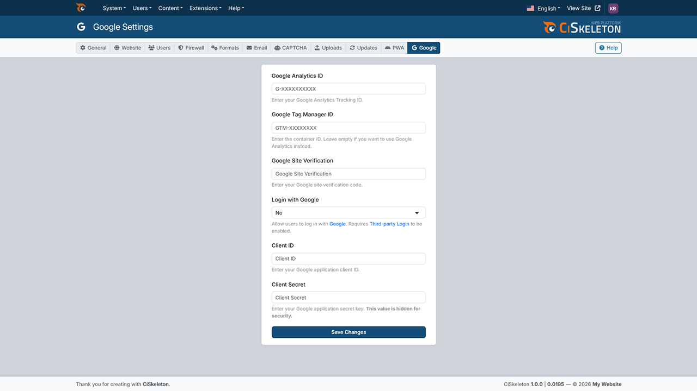
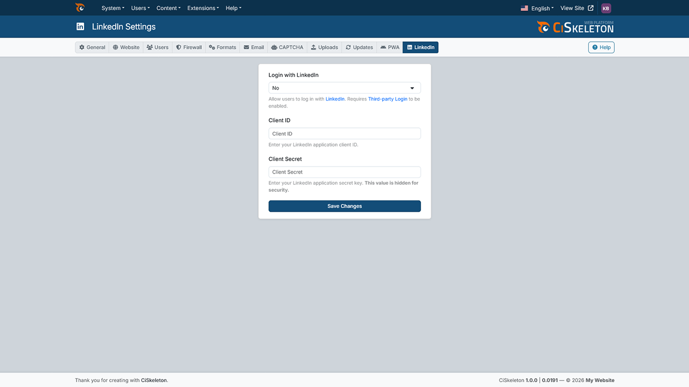
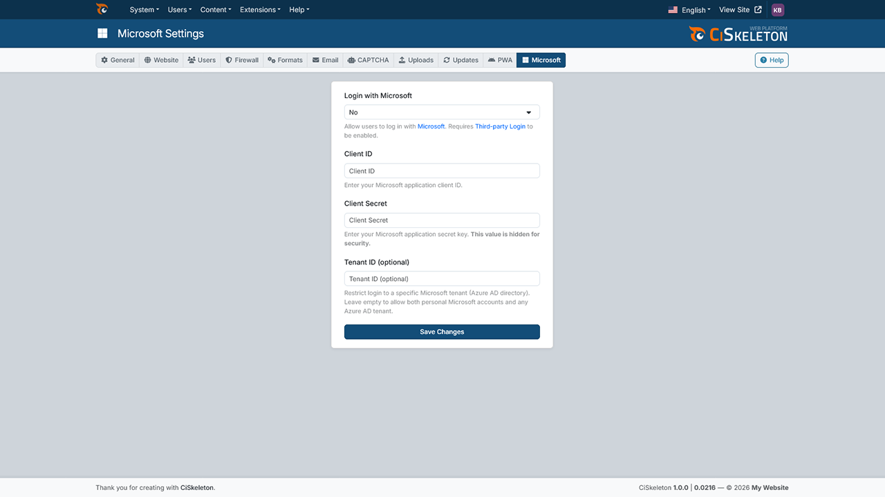

# CiSkeleton Plugin — OAuth Authentication

Adds OAuth-based third-party authentication to CiSkeleton, allowing users to log in using external providers such as **Google**, **Facebook**, **GitHub**, **Discord**, **LinkedIn**, and **Microsoft**.

<p align="center">
  
</p>

This plugin is designed to integrate cleanly with CiSkeleton’s settings system, authentication flow, and hook architecture.

## Features

- Third-party authentication using OAuth 2.0 providers
- Supports multiple providers out of the box:
  - Google
  - Facebook
  - GitHub
  - Discord
  - LinkedIn
  - Microsoft
- Provider-specific settings panels in the admin dashboard
- Fully integrated with CiSkeleton hooks and settings tabs
- Optional and non-intrusive: OAuth is disabled by default
- No impact on core authentication when disabled

## Requirements

- CiSkeleton
- PHP **8.0+**
- **cURL** enabled
- Valid OAuth credentials for the providers you want to enable

## Installation

1. Copy the plugin into your plugins directory.
2. Enable the plugin from the admin dashboard or plugin manager.
3. Activate the plugin to register its configuration options.

## Configuration

After activation, OAuth settings become available in the admin dashboard.

### Enable OAuth globally

Go to:
```nginx
Admin → Settings → Users
```

Enable:
- Allow OAuth Authentication

This toggle controls whether third-party login is available at all.

## Provider Configuration

Each provider has its own settings tab under Settings once the plugin is active:

- Google
- Facebook
- GitHub
- Discord
- LinkedIn
- Microsoft

For each provider:
1. Enable the provider
2. Enter the required Client ID
3. Enter the required Client Secret
> ⚠️ You must create OAuth applications on each provider’s developer portal and configure the correct callback URLs.

## How It Works

The plugin relies entirely on CiSkeleton’s hook system:

- Registers OAuth drivers during plugin boot
- Adds required options during plugin activation
- Injects settings into existing and custom settings tabs
- Initializes OAuth only when enabled
- Handles OAuth login flow through a dedicated `do_oauth` action

No core files are modified.

## Hooks Used

- `plugin_boot_oauth` — Registers OAuth drivers and autoloaded classes.
- `plugin_activate_oauth` — Adds required options to the database.
- `plugin_deactivate_oauth` — Removes all plugin-related options.
- `init` — Loads and initializes OAuth when enabled.
- `do_oauth` — Handles OAuth authentication flow.

## Filters

- `settings_fields_users` — Adds the global “Allow OAuth” toggle.
- `settings_other` — Registers provider-specific settings tabs.
- `settings_fields_google`
- `settings_fields_facebook`
- `settings_tab_discord`
- `settings_tab_github`
- `settings_tab_linkedin`

These filters integrate OAuth settings seamlessly into the admin UI.

## Security Notes

- CSRF protection is enforced using OAuth state validation
- OAuth is disabled by default
- No credentials are stored outside the database options table
- Providers are only initialized when explicitly enabled

## Uninstallation

Deactivating the plugin will:

- Remove all OAuth-related options from the database
- Disable third-party authentication immediately

No residual data is left behind.

## Screenshots

<details open>
  <summary><b>Frontend — Login</b></summary>
  <br>
  
</details>

<details>
  <summary><b>Settings — Discord</b></summary>
  <br>
  
</details>

<details>
  <summary><b>Settings — Facebook</b></summary>
  <br>
  
</details>

<details>
  <summary><b>Settings — GitHub</b></summary>
  <br>
  
</details>

<details>
  <summary><b>Settings — Google</b></summary>
  <br>
  
</details>

<details>
  <summary><b>Settings — LinkedIn</b></summary>
  <br>
  
</details>

<details>
  <summary><b>Settings — Microsoft</b></summary>
  <br>
  
</details>

## Roadmap

- Additional OAuth providers (optional)
- Improved error reporting per provider
- Optional account linking for existing users (in progress)

## License

Apache License 2.0. See [LICENSE](LICENSE.md) for details.

---

<div align="center">
  <sub><a href="https://github.com/ciskeleton">CiSkeleton</a> is created, developed, and maintained by <a href="https://github.com/bkader">Kader Bouyakoub</a>, trading as <a href="https://github.com/ianhubnet">Ianhub</a>.</sub>
</div>
